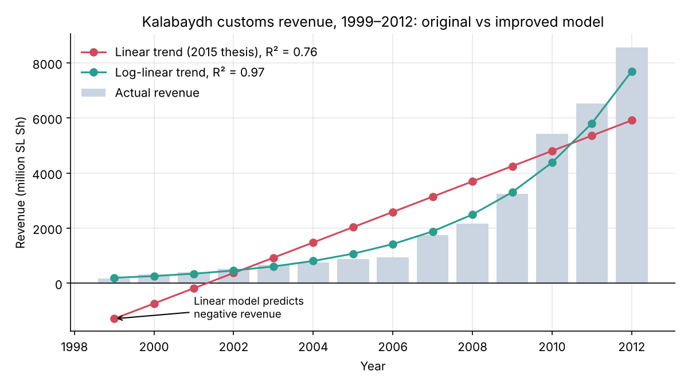
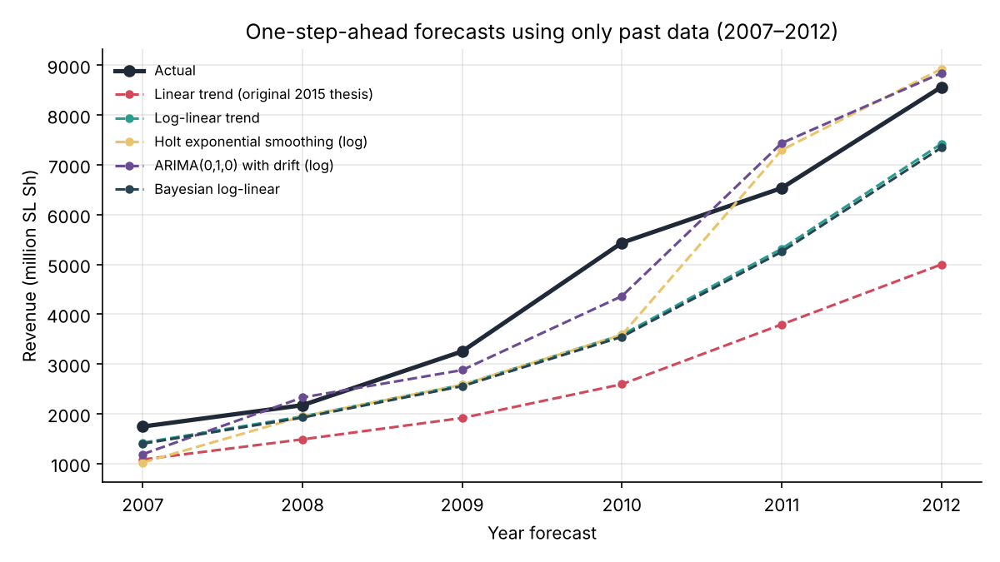
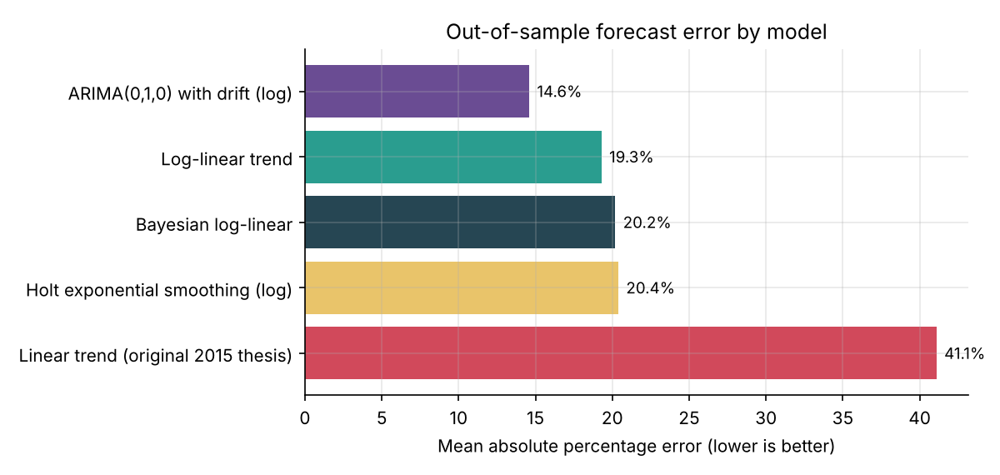
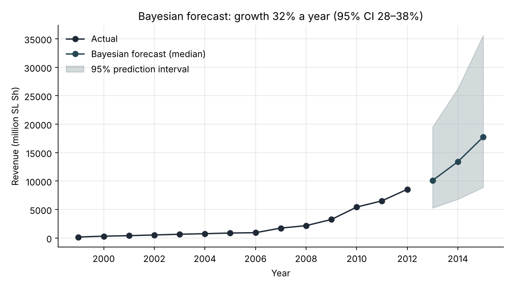

[](https://doi.org/10.5281/zenodo.24464265)

# Forecasting Customs Revenue in Somaliland: My MSc Thesis, Revisited

  

In 2015 I completed my MSc in Statistics at Kampala International University with a thesis titled **"Revenue Management and Forecasting System: A Case Study for Kalabaydh Custom in Somaliland"**. I built a database system for customs revenue and forecast future collections with a **linear time trend**.

Ten years later, after working with Somaliland's tax data at the Inland Revenue Department, I returned to the same data to ask a simple question:

> **How much better could the forecasts have been, using only the data that was available at the time?**

This repository reproduces the original model exactly and compares it, fairly and transparently, with four alternatives suited to short, fast-growing government revenue series.

---

## Key findings

| | Original linear trend (2015) | Best improved model |
|---|---|---|
| In-sample fit (R²) | 0.76 | **0.97** (log-linear) |
| In-sample error (MAPE) | 145.1% | **13.3%** (Holt, log scale) |
| Out-of-sample forecast error, 2007–2012 (MAPE) | 41.1% | **14.6%** (ARIMA with drift, log scale) |
| Fitted revenue for 1999 (actual: 173) | **−1,290 million SL Sh** (impossible) | 198 million SL Sh (log-linear) |

1. **The original linear model did not match the shape of the data.** Revenue grew about 50-fold between 1999 and 2012, an exponential pattern. A straight line underestimates recent years and even predicts negative revenue for the early years.
2. **Modelling growth on the log scale fixes this.** Revenue grew by about **32.5% a year**, and the Bayesian model gives a 95% credible interval of 28–38%.
3. **Honest evaluation changes the ranking.** Fitted to all 14 years, the models look similar. When each model may only use past data to forecast next year (rolling-origin evaluation), a simple **random walk with drift on the log scale** is the most accurate, with a forecast error of 14.6% compared with 41.1% for the original model.
4. **Uncertainty matters for short series.** With only 14 annual observations, prediction intervals are wide. The Bayesian model makes this explicit, which is essential for budget planning.



---

## Data

`data/kalabaydh_revenue_1999_2012.csv` contains total annual revenue collected at Kalabaydh customs, 1999–2012, in millions of Somaliland Shillings. **Source:** Ministry of Finance, Somaliland, as published in Appendix I of my 2015 thesis.

The data are **aggregated annual totals** and contain no information about individual taxpayers.

| Year | 1999 | 2002 | 2005 | 2008 | 2010 | 2012 |
|---|---|---|---|---|---|---|
| Revenue (million SL Sh) | 173 | 534 | 878 | 2,173 | 5,436 | 8,564 |

---

## Models compared

| Model | Idea | Why it fits revenue data |
|---|---|---|
| **Linear trend** (original thesis) | revenue = a + b · year | Baseline, reproduced exactly: a = −1,109,342, b = 554.3 |
| **Log-linear trend** | log(revenue) = a + b · year | Constant percentage growth; forecasts can never be negative |
| **Holt exponential smoothing** (log) | Level and trend updated over time | Adapts when growth speeds up or slows down |
| **ARIMA(0,1,0) with drift** (log) | Next year = this year × average growth | Uses the latest observation; strong for short series |
| **Bayesian log-linear** | Log-linear trend with weakly-informative priors | Full uncertainty for parameters and forecasts |

Accuracy uses the same four measures as the original thesis: **Bias, MAD, MAPE and MSE**.

---

## Results

### 1. Out-of-sample forecasts (the fair test)

Each model is refitted on data up to year *t* and forecasts year *t + 1*, for 2007 to 2012. This is how a revenue office actually forecasts next year's budget.

| Model | Bias | MAD | MAPE (%) | MSE |
|---|---:|---:|---:|---:|
| **ARIMA(0,1,0) with drift (log)** | 111.1 | 556.7 | **14.6** | 419,439 |
| Log-linear trend | 906.1 | 906.1 | 19.3 | 1,138,075 |
| Bayesian log-linear | 946.3 | 946.3 | 20.2 | 1,226,623 |
| Holt exponential smoothing (log) | 391.3 | 766.4 | 20.4 | 861,114 |
| Linear trend (original 2015 thesis) | 1,972.1 | 1,972.1 | 41.1 | 5,164,291 |

Positive bias means forecasts were too low. Every model underestimated the rapid growth after 2009, but the original linear trend did so by far the most.





### 2. In-sample fit (all 14 years)

| Model | Bias | MAD | MAPE (%) | MSE |
|---|---:|---:|---:|---:|
| Linear trend (original 2015 thesis) | 0.0 | 1,103.4 | 145.1 | 1,598,635 |
| Log-linear trend | 115.5 | 297.3 | 15.5 | 199,647 |
| Holt exponential smoothing (log) | 24.5 | 256.3 | 13.3 | 149,276 |
| ARIMA(0,1,0) with drift (log) | 3.7 | 272.9 | 13.5 | 163,360 |
| Bayesian log-linear | 126.8 | 300.4 | 15.4 | 209,732 |

### 3. Forecasting with uncertainty



The Bayesian model was fitted only to data up to 2012. Its forecasts for 2013–2015 are **illustrative** and have not been compared with actual collections.

---

## What I would do differently today

- **Look at the shape of the data first.** Exponential growth calls for a log scale.
- **Evaluate forecasts out of sample**, not only on the data used for fitting.
- **Report uncertainty**, not just a single number, especially with few observations.
- **Use explanatory variables** where available, such as trade volumes, exchange rates, tax-rate changes and the opening of new trade routes.
- **Treat structural breaks explicitly.** The jump after 2006 likely reflects administrative and trade changes, not only steady growth.

These questions shape my current research interest: **reliable statistical and machine learning methods for official and public-finance statistics in data-scarce countries.**

---

## How to reproduce

```bash
git clone https://github.com/mohamedabeye/somaliland-revenue-forecasting.git
cd somaliland-revenue-forecasting
pip install -r requirements.txt
python run_analysis.py
```

All tables are written to `results/` and all figures to `figures/`.

## Repository structure

```
somaliland-revenue-forecasting/
├── data/
│   └── kalabaydh_revenue_1999_2012.csv   # Annual revenue, 1999–2012 (thesis Appendix I)
├── src/
│   └── forecasting.py                    # Models, accuracy measures, rolling-origin evaluation
├── results/                              # Accuracy tables and forecasts (CSV)
├── figures/                              # Charts used in this README
├── run_analysis.py                       # Reproduces every result
├── requirements.txt
└── LICENSE
```

---

## About me

**Mohamed Abdillahi Abeye**: MSc Statistics (Kampala International University) · BSc Computer Science (Eelo University) · Data & database lead for the Inland Revenue Department, Somaliland (since 2018) · Lecturer in programming, University of Hargeisa (since 2015).

📧 mohamedaabeye@gmail.com

## Citation

If you use this work, please cite the preprint:

> Abeye, M. A. (2026). *Forecasting Customs Revenue in a Data-Scarce Economy: Revisiting a Linear Trend Model for Kalabaydh, Somaliland* [Preprint]. Zenodo. https://doi.org/10.5281/zenodo.24464265

The original thesis:

> Abeye, M. A. (2015). *Revenue Management and Forecasting System: A Case Study for Kalabaydh Custom in Somaliland*. MSc thesis, Kampala International University. Revisited analysis (2026): https://github.com/mohamedabeye/somaliland-revenue-forecasting
